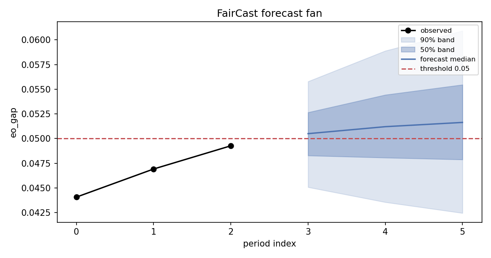

# FairCast forecast report

- Metric: **eo_gap**, threshold 0.05 (breach direction: above)
- Last observed period: 2016 — current value 0.0493
- P(breach within 3 periods): **0.762**
- Median breach horizon: 1
- Intervals: not calibrated

> **What this forecast is, and is not.** The breach probabilities come
> from a per-cell state-space model of the underlying group rates,
> propagated through the metric. They are *not* a promised lead time:
> in Paper 11 (Ghosh, submitted to AI & Society, 2026), a forecaster of
> this family was pre-registered against persistence and linear
> extrapolation at matched false-alarm rates and **did not beat
> extrapolation on median lead** — the claim was reported falsified.
> Run `faircast benchmark` on your own panels; FairCast prints
> NO-SKILL whenever it does not beat both trivial forecasters. Alarm
> budgets likewise do not transport for free: thresholds fitted to a
> 0.10 false-alarm target on one jurisdiction fired at 0.293 on others
> in Paper 11's corpus, so recalibrate per series and read the
> *achieved* backtest rate, not the target.

## Breach probability by horizon

| period | P(first breach in period) | P(breach by period) |
|---|---|---|
| 2017 | 0.565 | 0.565 |
| 2018 | 0.139 | 0.703 |
| 2019 | 0.059 | 0.762 |

## First-breach distribution

- 2017: 0.565
- 2018: 0.139
- 2019: 0.059
- none: 0.237

## Self-benchmark (FAR-matched)

Series: 18 (5 breaching inside the monitored window, 6 already in breach before the first origin and excluded from coverage).

| method | FAR target | achieved FAR | coverage | median lead | Brier |
|---|---|---|---|---|---|
| faircast | 0.05 | 0.143 | 0.000 | 0.0 | 0.319 |
| persistence | 0.05 | 0.071 | 0.000 | 0.0 | 0.304 |
| linear | 0.05 | 0.071 | 0.000 | 0.0 | 0.327 |
| faircast | 0.10 | 0.143 | 0.000 | 0.0 | 0.319 |
| persistence | 0.10 | 0.071 | 0.000 | 0.0 | 0.304 |
| linear | 0.10 | 0.071 | 0.000 | 0.0 | 0.327 |
| faircast | 0.20 | 0.143 | 0.000 | 0.0 | 0.319 |
| persistence | 0.20 | 0.214 | 0.000 | 0.0 | 0.304 |
| linear | 0.20 | 0.214 | 0.000 | 0.0 | 0.327 |

- FAR target 0.05: NO-SKILL — faircast median lead 0.0 does not exceed both trivial forecasters (persistence 0.0, linear 0.0) at matched FAR.
- FAR target 0.10: NO-SKILL — faircast median lead 0.0 does not exceed both trivial forecasters (persistence 0.0, linear 0.0) at matched FAR.
- FAR target 0.20: NO-SKILL — faircast median lead 0.0 does not exceed both trivial forecasters (persistence 0.0, linear 0.0) at matched FAR.

